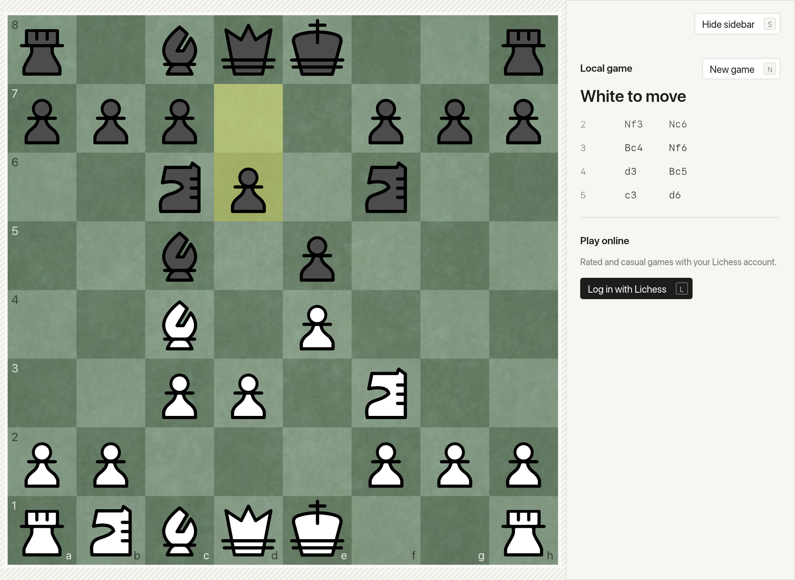
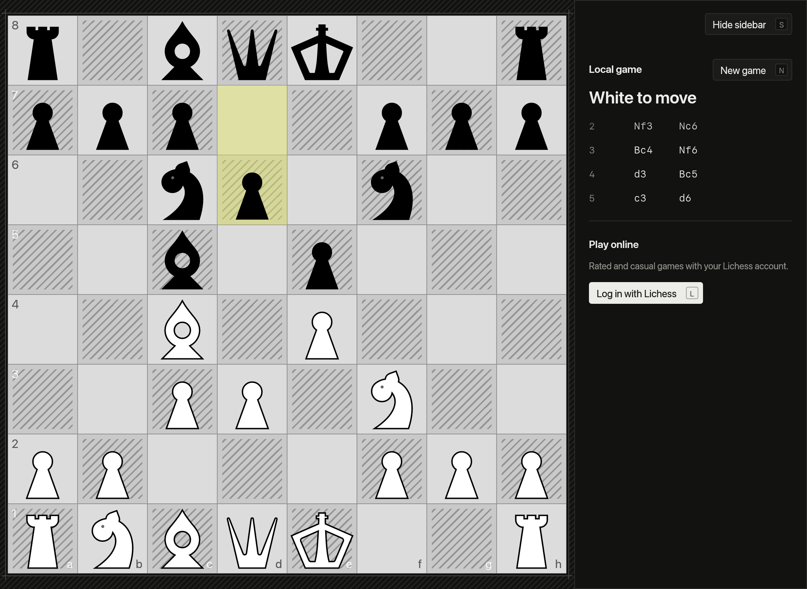

# Caturankam

`/sʌ.t̪ʊ.ɾʌŋ.ɡʌm/`

A super-lightweight native chess client for Lichess, written in Rust. No browser engine,
no Electron. Caturankam (சதுரங்கம்) is the Tamil name for chaturanga, chess's ancient
Indian ancestor.

Caturankam for Lichess is an independent project, not an official Lichess app.





## Install

**[Download the latest release](https://github.com/deepakvettickal/caturankam/releases/latest)**
(`Caturankam-x.y.z.dmg`), open it, and drag **Caturankam** to **Applications**.
Needs macOS 11 or later; runs natively on Apple Silicon and Intel.

Or with [Homebrew](https://brew.sh), straight from this repository:

```sh
brew tap deepakvettickal/caturankam https://github.com/deepakvettickal/caturankam
brew install --cask caturankam
```

**First launch.** Releases aren't notarized by Apple yet, so macOS blocks the app the
first time:

1. Open Caturankam, and choose **Done** when macOS says it can't be verified.
2. Open **System Settings ▸ Privacy & Security**, scroll down, and click **Open Anyway**
   next to Caturankam. Confirm with **Open Anyway** and your password.

You only do this once. macOS may also ask to let Caturankam use your Keychain, where
your Lichess login is stored; choose **Always Allow**. It asks again after each update,
until releases are signed.

## What it does

Version 1, in the **Original** mode. Zen, Chaos and Ancient modes come later.

- **Log in with Lichess:** OAuth with PKCE in your browser. The token stays in the macOS
  Keychain, never on disk.
- **Play online:** Rapid and Classical quick pairing, the Lichess computer at levels
  1–8, or challenge a friend (Blitz works with both). Accept challenges from others,
  premove, offer draws, resign, abort, and claim victory if your opponent leaves. It
  reconnects if the connection drops.
- **Step through any game** with the arrow keys, or click a move.
- **Sounds** for moves, captures, check, and the start and end of a game. They're made in
  code, so there's nothing to download.
- **Every Lichess piece set and board** (41 and 25), downloaded only when you pick one.
- **A Mac app:** native menu bar, light and dark appearance, a collapsible sidebar, and a
  shortcut for every action.
- **A local board** to play both sides offline.

## Keyboard

Every action has a single key, shown on its button. Menu items also have ⌘ shortcuts.

| Where | Keys |
|---|---|
| Anywhere | **F** flip · **S** sidebar · **T** light/dark · **M** sound · **R** random pieces and board · **L** log in · **N** new local game |
| Moves | **← →** step back and forward · **↑** start · **↓** back to live |
| Lobby | **1–5** quick pairing · **6–0, -** play the computer · **[ ]** computer level · **C** colour · **U** challenge a friend |
| Challenges | **Y** accept · **Esc** decline (or withdraw yours) |
| In a game | **A** abort · **X** resign (press twice) · **O** offer draw · **Y** accept draw · **V** claim victory · **Esc** decline, cancel, or drop a premove · **↵** back to lobby |
| Promotion | **Q R B N** |

**Premoves:** during your opponent's turn, make your move as usual. It's queued (shown
in blue) and played the instant their move lands, if it's still legal. Right-click or
**Esc** drops it.

With the sidebar hidden, the window title shows both players and their clocks.

## How light is it?

Caturankam vs Lichess in Google Chrome, idle on a board. Same machine, same minute. Chrome
used a fresh profile with no extensions. Memory is the sum of physical footprint across
all of each app's processes. CPU is averaged over 20 seconds.

| | Processes | Memory | CPU (idle) |
|---|---:|---:|---:|
| **Caturankam**, idle board | 1 | **66 MB** | **0.0%** |
| Chrome + lichess.org (home page) | 11 | 614 MB | 11.1% |
| Chrome + lichess.org/analysis (board) | 10 | 619 MB | 1.4% |
| *Only the Lichess tab* (home / analysis), if Chrome is already open | 4 / 3 | 166 / 121 MB | 6.8% / 0.1% |

Caturankam uses about **9× less memory** than Lichess in a fresh browser, and still about
2× less than the Lichess tab alone in a browser that's already open. With a Lichess board
image and piece set loaded and a larger window, it measured about 92 MB.

- **Machine:** MacBook Pro 13" (M1, 8 GB), macOS 26.5, Chrome 155, 14 October 2026.
- **Caturankam:** run in demo mode (`CATURANKAM_DEMO=1`, see below): logged out, nothing
  downloaded.
- **Release binary:** 14 MB.
- **Lazy loading:** the network thread, piece sets and boards load only when used.

## Build from source

You need macOS and the stable [Rust toolchain](https://rustup.rs).

```sh
cargo run --release
```

To build the app and DMG as a release does:

```sh
cargo build --release
packaging/macos/bundle.sh target/release/caturankam dist/Caturankam.app 1.0.0
packaging/macos/dmg.sh dist/Caturankam.app dist/Caturankam-1.0.0.dmg
```

[CONTRIBUTING.md](CONTRIBUTING.md) covers the workflow and the release process.

### Screenshots and benchmarks

Demo mode gives a clean state that never touches your settings or login:

```sh
CATURANKAM_DEMO=1 CATURANKAM_MOVES="e2e4 e7e5 g1f3" CATURANKAM_SHOT=out.png cargo run --release
```

`CATURANKAM_DARK=1` switches to dark, and `CATURANKAM_PIECES` / `CATURANKAM_BOARD`
pick a Lichess set and board. With `CATURANKAM_SHOT` the window captures itself and
quits.

## Layout

| Crate | Role |
|---|---|
| `crates/core` | Game model on top of `shakmaty`. No I/O, no UI. |
| `crates/theme` | Theme manifest (`themes/*/theme.toml`) schema and loading. |
| `crates/lichess` | Lichess API client: login, streams, seeks, moves. |
| `crates/app` | The `eframe` app: board widget, screens, menu bar, design system. |

## To do

**Play**
- [x] Premoves
- [x] Sounds (move, capture, check, game start/end), lazy-loaded
- [x] Challenge a friend by username (Blitz is allowed in direct challenges)
- [x] Accept incoming challenges
- [ ] Correspondence games (several games at once, over days)
- [x] Claim victory when the opponent leaves
- [x] Step back through the move list during and after a game
- [x] 5+0 against the computer
- [x] Material lead (+N) beside the player who is ahead

**Modes** (the point of the project)
- [ ] Theme system: every visual and sound from a theme pack, loaded from disk
- [ ] Mode selector
- [ ] **Zen:** soft palette, slow eased animations, ambient sound
- [ ] **Chaos:** screen shake, combo streaks, particles, escalating music
- [ ] **Ancient:** chaturanga/shatranj art, piece names, war drums

**Mac app**
- [x] `.app` bundle with an icon, a DMG, and a Homebrew cask
- [x] First release, with a CHANGELOG and release workflow
- [ ] Signing and notarization (needs an Apple Developer account), so macOS opens it
      normally and the Keychain doesn't ask again after updates
- [ ] Appearance: follow the system's light/dark setting
- [ ] Check for updates

**Later**
- [ ] Windows build with native menus
- [ ] Post-game analysis with a local Stockfish (never during live games)
- [ ] Offline shatranj against a local engine
- [ ] User-made theme packs

## Inspirations

- **[Lichess](https://lichess.org):** the platform, the
  [Board API](https://lichess.org/api#tag/board), and its open source:
  [lila](https://github.com/lichess-org/lila),
  [chessground](https://github.com/lichess-org/chessground) and the
  [mobile app](https://github.com/lichess-org/mobile). Studied for behaviour; no code
  copied.
- **[Langfuse](https://langfuse.com):** the design language: paper, hairlines, one
  highlighter accent, and a keyboard shortcut on every action.
- **[spotifast](https://github.com/crmne/spotifast):** how to build a fast, native Rust
  app on egui, how to package and release it for the Mac, and the fix for the Touch Bar
  crash on close.
- **[egui](https://github.com/emilk/egui)** and **[shakmaty](https://github.com/niklasf/shakmaty):**
  the UI toolkit and the chess rules underneath.
- **[Cburnett's pieces](https://commons.wikimedia.org/wiki/Category:SVG_chess_pieces):**
  the built-in set.

## Licence

MIT. See [LICENSE](LICENSE) and [ASSETS.md](ASSETS.md) for asset licences.
`crates/app/src/mac_crash_guard.rs` is adapted from
[spotifast](https://github.com/crmne/spotifast) (MIT); its notice is kept in the file.
